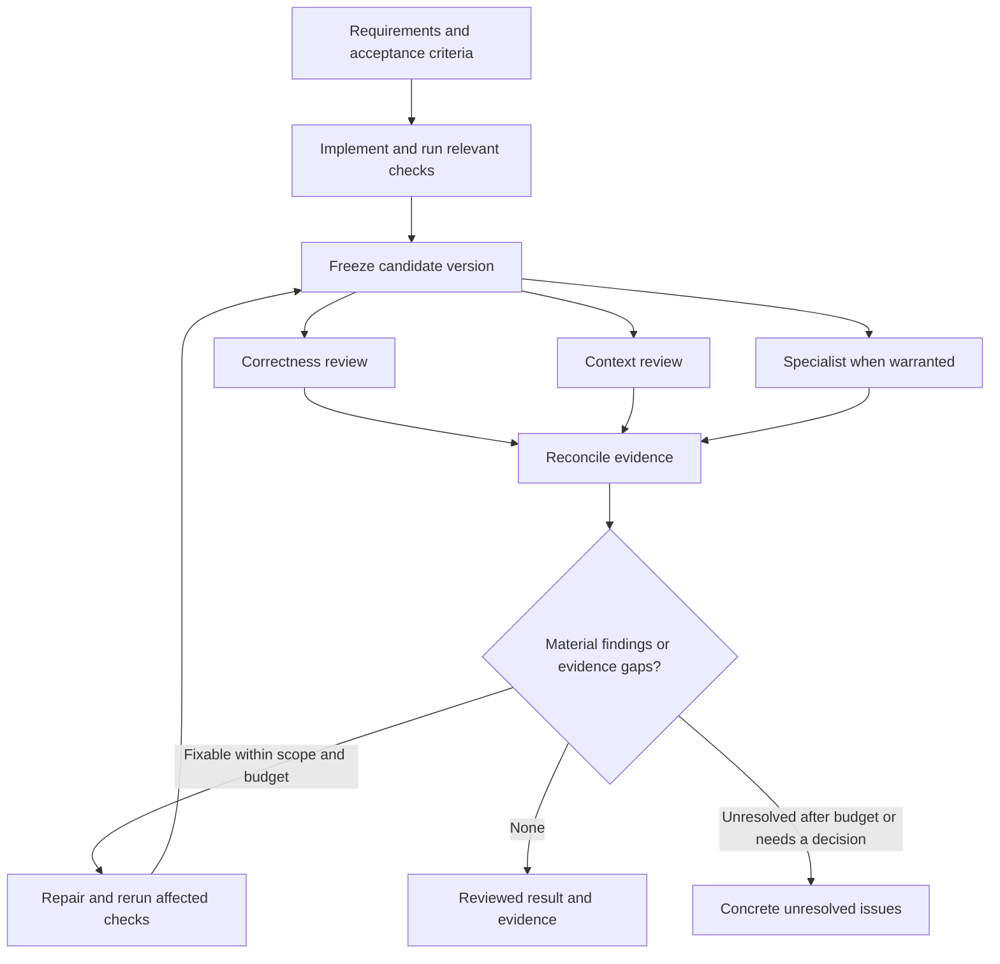

# Agent review for coding sessions

Status: reusable template, not installed or activated. Prepared 24 October 2026.

This setup turns the supplied diagram's three ideas into an operating procedure: check implementation, check context, and leave consequential decisions with the person responsible. The diagram's company anecdotes and numerical claims are not treated as verified evidence.

## The team

| Role | Responsibility | Deliverable |
| --- | --- | --- |
| Main agent: implementer and coordinator | Establish acceptance criteria, write code, run checks, collect independent reviews, reconcile evidence, make bounded repairs | Versioned candidate and final review record |
| Correctness reviewer | Find concrete bugs, regressions, weak tests, failure cases and interface problems | Findings with locations, triggers and evidence |
| Context reviewer | Compare behavior with the user's request, repository decisions, callers, data contracts and constraints | Requirement coverage, contradictions and missing context |
| Optional specialist | Examine the main additional risk: numerical/scientific validity, security, migration, performance or UI behavior | Focused evidence for that risk |
| Human owner | Resolve material ambiguity, accept explicit tradeoffs and authorize consequential actions when needed | Decision on a concrete result, under the existing authorization policy |

The main agent can write and coordinate. The independent reviewers do not write the implementation they review. Use separate fresh contexts and withhold the author's persuasive explanation and other reviews until initial findings are returned. Different roles reduce duplicated attention; agreement is not proof and shared model blind spots remain possible.

Default budget: initial review plus at most two repair-and-review rounds, three review passes total. Stop early when the criteria are met. Do not restart the counter by renaming the candidate or assigning a new agent.

## Effort per change

| Change | Review arrangement |
| --- | --- |
| Small, local, low-consequence code edit | One fresh reviewer covers correctness and context; direct inspection or existing relevant checks may suffice |
| Normal behavioral change | Two fresh reviewers in parallel: correctness and context |
| Change with substantial scientific, security, data, compatibility or operational consequences | Those two plus a relevant specialist and stronger targeted evidence |

Choose by consequence and uncertainty, not line count. For a large change, review bounded components and then their integration. Respect available concurrency; queue roles rather than silently omit them. An independent reviewer failure means incomplete coverage until replaced or reported.

## What counts as a reviewed result

The exact candidate is identified; the requirements and necessary project context were checked; relevant validation has observed results; no material defect or requirement remains unresolved. Every finding is either fixed and rechecked, disproven with evidence, or explicitly recorded as an accepted/deferred limitation where appropriate. A clean agent review is not a guarantee of correctness or an approval to merge, deploy or publish.

The report distinguishes PASS, CHANGES_REQUIRED and INCOMPLETE. If a required test cannot run or essential context is missing, say INCOMPLETE. If code changes after review, the affected review and checks become stale. See the skill for the precise decision rules.

For numerical research, passing software tests establishes only the tested behavior. Scientific review also considers units, signs, dimensions, missing values, tolerances, independent reference cases, provenance and whether reported outputs actually finished. Physical validity and production completion need their own evidence.

## Files and use

- [Skill entrypoint](skill/agent-code-review/SKILL.md): reusable orchestration procedure.
- [Reviewer prompts](skill/agent-code-review/references/reviewer-prompts.md): fresh-context role instructions.
- [Review record](skill/agent-code-review/assets/review-record.md): a compact packet and results template.
- [Future session-default snippet](AGENTS-snippet.txt): instructions to opt in later.

To try it in one future coding session without installing it, paste this request and provide the absolute path to this package:

> Use the agent-code-review skill at [absolute package path]/skill/agent-code-review/SKILL.md for this coding task. Establish acceptance criteria, implement the requested change, then run independent review and bounded repair before reporting completion. Keep review tied to the final candidate and report any incomplete checks. Do not install the skill or change persistent settings.

For future persistent activation, copy only the `skill/agent-code-review` folder into an appropriate skill location, then merge the snippet into the intended active instructions file without replacing existing guidance. Current official documentation lists project `.agents/skills/` and personal `~/.agents/skills/` locations. Global instructions normally live at `~/.codex/AGENTS.md` (or the configured Codex home); check for overriding files and project instructions. Start a fresh session and verify the skill and instruction sources are loaded. None of those activation steps has been performed here. [Skills](https://learn.chatgpt.com/docs/build-skills), [AGENTS.md](https://learn.chatgpt.com/docs/agent-configuration/agents-md).

This is an instruction-based workflow using available subagent tools. It is not an event hook or a CI merge gate. If mandatory enforcement outside agent behavior is later required, implement a separate CI policy against the exact reviewed revision. Codex supports subagents and custom roles, but instructions asking a reviewer to avoid edits do not create a separate read-only sandbox. [Subagents](https://learn.chatgpt.com/docs/agent-configuration/subagents).
